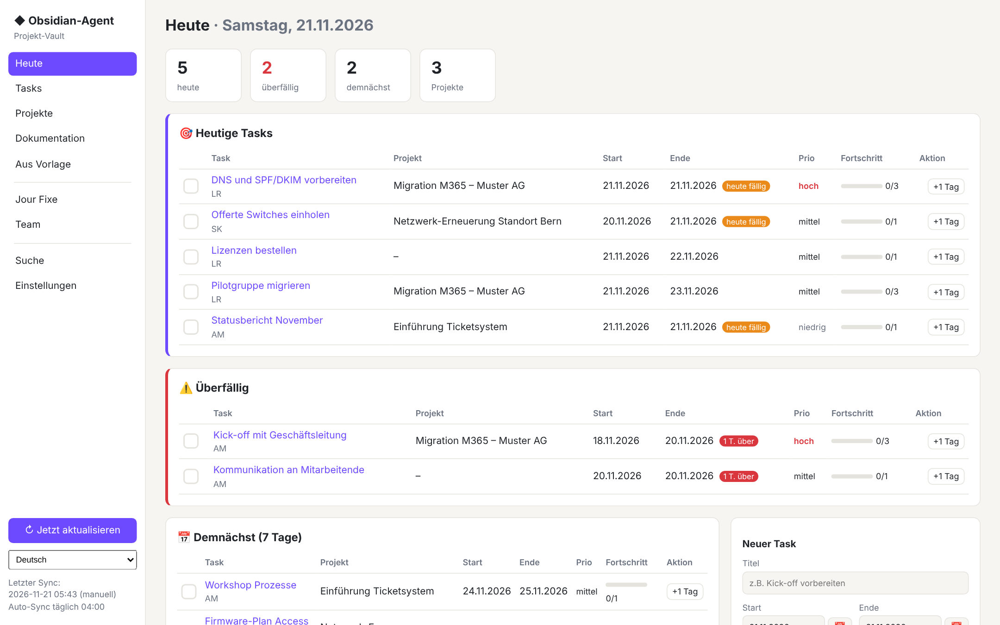
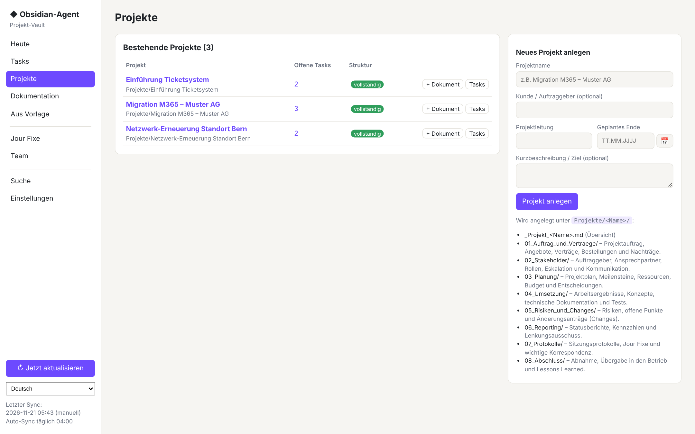
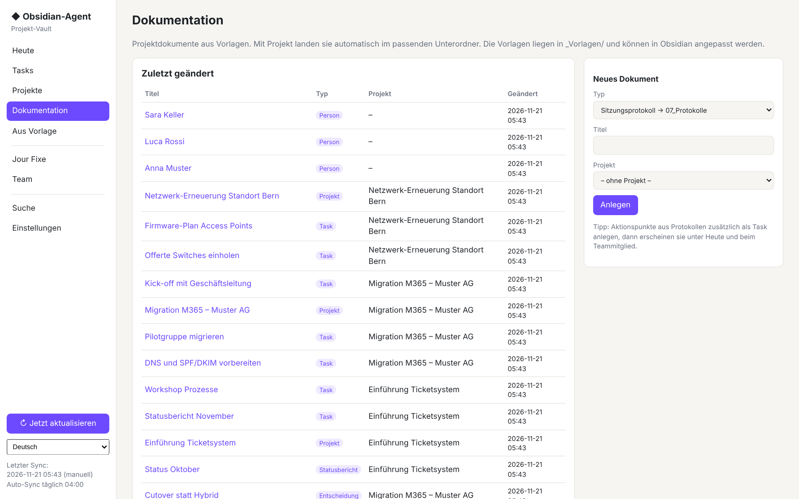
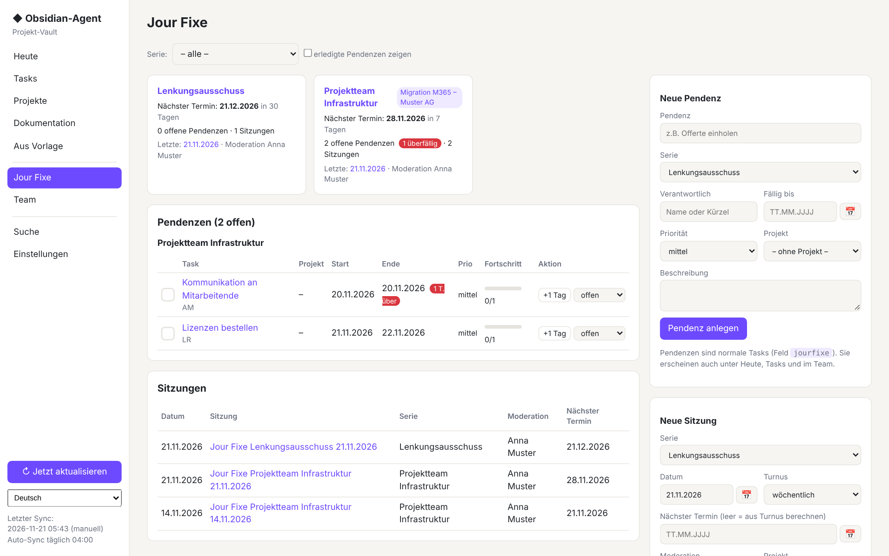
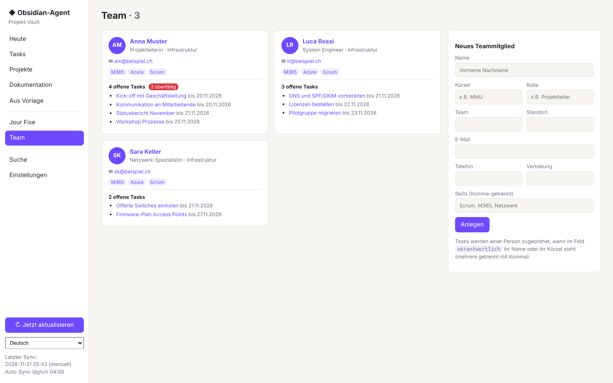
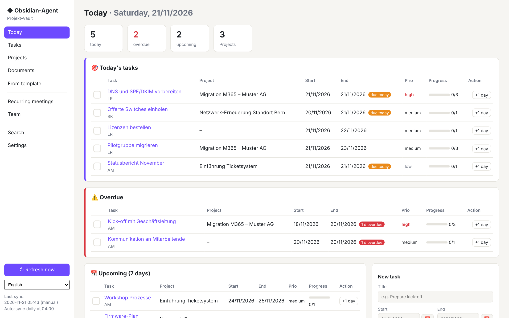
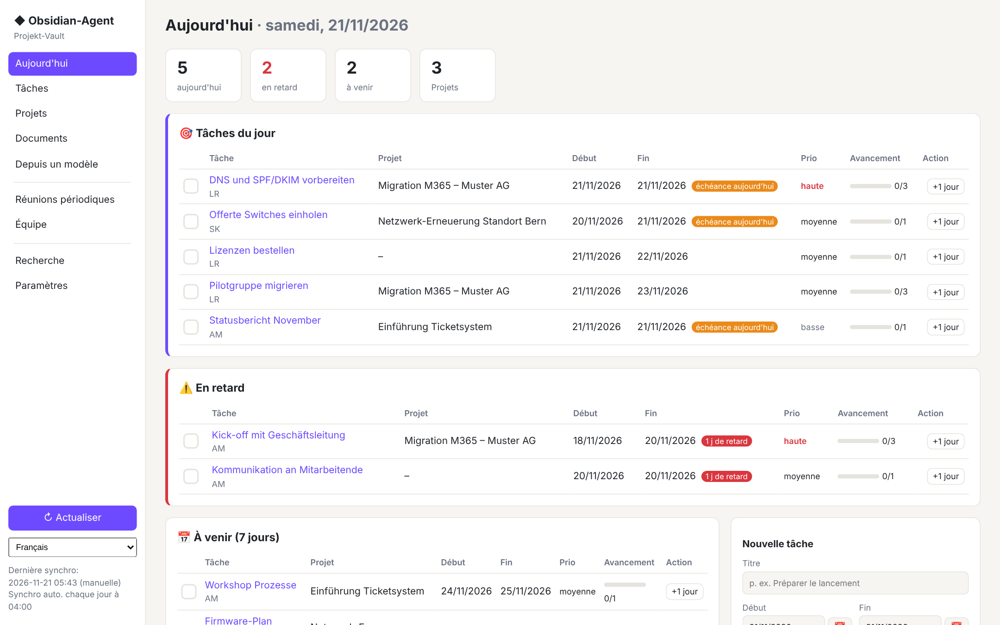
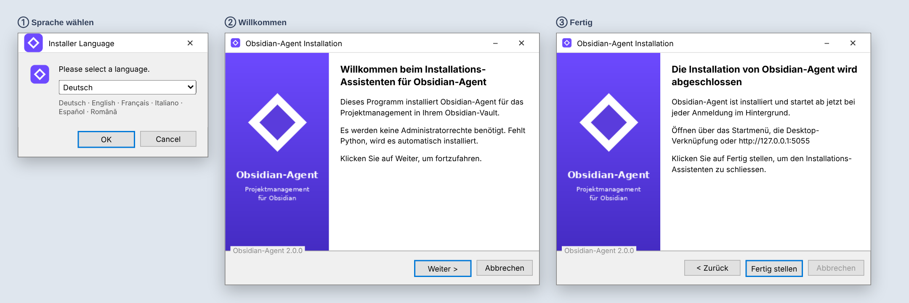

# ◆ Obsidian-Agent

**Deutsch** · [English](readme_en.md) · [Español](readme_es.md)

**Projektmanagement direkt in Ihrem Obsidian-Vault.**
Projekte, Tasks, Protokolle, Jour Fixes und das ganze Team: auf einen Blick, im Browser, und alles bleibt reines Markdown.

`Windows` `macOS` `Linux` `Python 3.9+` `läuft nur auf 127.0.0.1` `🇩🇪 🇬🇧 🇫🇷 🇮🇹 🇪🇸 🇷🇴`

---

## Das Problem

Obsidian ist grossartig zum Denken und Schreiben. Aber sobald mehrere Projekte, Meilensteine, Sitzungen und Pendenzen zusammenkommen, verteilt sich alles über Dutzende Notizen. Tasks verstecken sich in Protokollen, Fälligkeiten in Checkboxen, und wer was bis wann erledigt, steht irgendwo.

> Was ist heute fällig, was ist überfällig, und wer kümmert sich darum?

Diese Frage sollte in zehn Sekunden beantwortet sein, nicht in zehn Minuten.

## Die Lösung

Obsidian-Agent legt eine schlanke Projektmanagement-Oberfläche über Ihren Vault. Kein neues Tool, keine Cloud, kein Datensilo: Der Agent liest und schreibt ganz normale Markdown-Dateien.

| | |
|---|---|
| 🎯 **Alles auf einen Blick** | Heute, überfällig, demnächst, für alle Projekte und Personen. |
| 📝 **Markdown bleibt die Wahrheit** | Jede Notiz ist eine Datei in Ihrem Vault. Sie arbeiten weiter in Obsidian, wann immer Sie wollen. |
| 🔗 **Ein Klick nach Obsidian** | Jeder Titel öffnet die Notiz direkt in Obsidian. |
| 🔒 **100 % lokal** | Läuft nur auf Ihrem Computer. Keine Daten verlassen Ihr Gerät. |
| ⏰ **Arbeitet im Hintergrund** | Startet bei der Anmeldung und erstellt jeden Morgen um 04:00 die Tagesübersicht, auch in Obsidian und auf dem Handy. |
| 🌍 **Sechs Sprachen** | Deutsch, Englisch, Französisch, Italienisch, Spanisch und Rumänisch, inklusive Vorlagen und Ordnernamen. |

## Funktionen

### 🎯 Heute: der Tag beginnt mit Klarheit

Heutige Tasks, Überfälliges und das, was in den nächsten Tagen ansteht, mit Priorität, Fortschritt und Verantwortlichen. Ein Klick hakt ab, ein weiterer verschiebt auf morgen. Neue Tasks legen Sie direkt hier an.

### 📁 Projekte: Struktur ab der ersten Minute

Ein Klick, und jedes Projekt hat dieselbe saubere Ablage, von Auftrag bis Abschluss:

`01_Auftrag_und_Vertraege` · `02_Stakeholder` · `03_Planung` · `04_Umsetzung` · `05_Risiken_und_Changes` · `06_Reporting` · `07_Protokolle` · `08_Abschluss`

Dazu eine Projektübersicht mit Zielen, Meilensteinen und offenen Tasks.

### 📄 Dokumentation: die richtige Vorlage am richtigen Ort

Sitzungsprotokoll, Entscheidung, Risiko, Änderungsantrag, Stakeholder, Statusbericht und Projektabschluss. Jedes Dokument landet automatisch im passenden Projektordner, mit einheitlicher Gliederung. Alle Vorlagen passen Sie in Obsidian an.

### 🗓️ Jour Fixe: keine Pendenz geht mehr verloren

Sitzungsserien mit Turnus und nächstem Termin. Jede neue Sitzungsnotiz enthält automatisch alle offenen Pendenzen der Serie. Pendenzen sind normale Tasks und erscheinen auch unter Heute und beim Teammitglied.

### 👥 Team: wer macht was bis wann

Personenkarten mit Rolle, Kontakt und Vertretung und den offenen und überfälligen Tasks jeder Person. Die Zuordnung läuft einfach über Name oder Kürzel.

### ✅ Tasks: alle Aufgaben, ein Ort

Alle Tasks nach Heute, Überfällig, Geplant und Erledigt, filterbar nach Projekt. Status per Auswahl, Fortschritt aus den Checkboxen, Ablage wahlweise in jedem Projektordner.

### 🌍 Ihre Sprache, Ihr Team

Die Oberfläche wechselt mit einem Klick. Vorlagen und Ordnernamen entstehen in der gewählten Sprache. Weil die Feldnamen in allen Sprachen gleich bleiben, liest der Agent jeden Vault, auch in gemischten Teams.

| English | Français |
|---|---|
|  |  |

### Und ausserdem

- 🔍 Volltextsuche über den ganzen Vault
- 🧩 Eigene Vorlagen mit vorgewähltem Zielordner
- 📲 Tagesübersicht als Notiz in Obsidian, inklusive Archiv pro Tag
- 📊 Optional mit Dataview-Abfragen in jeder Projektübersicht
- ⌨️ Kommandozeile für Sync, Tagesliste und neue Projekte

## Warum nicht einfach ein Plugin?

| | Obsidian-Agent | Obsidian-Plugins |
|---|:---:|:---:|
| Übersicht, auch wenn Obsidian geschlossen ist | ✅ | – |
| Tägliche Aktualisierung im Hintergrund | ✅ | – |
| Feste Projektstruktur mit einem Klick | ✅ | – |
| Jour Fixe mit automatischer Pendenzenliste | ✅ | – |
| Tageshistorie: wer hat wann was erledigt | ✅ | – |
| Notizen bleiben reines Markdown | ✅ | ✅ |
| Funktioniert mit Dataview zusammen | ✅ | ✅ |

## In 5 Minuten startklar

### Windows

1. **[Obsidian-Agent-Setup-2.0.0-Windows.zip herunterladen](Obsidian-Agent-Setup-2.0.0-Windows.zip)** und entpacken.
2. `Obsidian-Agent-Setup-2.0.0.exe` starten. Erscheint «Der Computer wurde durch Windows geschützt»: **Weitere Informationen → Trotzdem ausführen**.
3. Sprache wählen, **Weiter**, Vault-Ordner auswählen, **Fertig stellen**.

Keine Administratorrechte nötig. Fehlt Python, wird es automatisch installiert.

### macOS

1. **[Obsidian-Agent-2.0.0-Mac.zip herunterladen](Obsidian-Agent-2.0.0-Mac.zip)**, entpacken und `Obsidian-Agent-2.0.0.pkg` doppelklicken.
2. Falls macOS warnt: **Systemeinstellungen → Datenschutz & Sicherheit → Dennoch öffnen**.
3. Der Installation folgen und den Vault wählen. Der Agent startet unter **Programme → Obsidian-Agent**.

Danach ist der Agent immer erreichbar unter **http://127.0.0.1:5055**.

📖 **[Alle Anleitungen und Kurzinstallation in 6 Sprachen](obsidian-agent-readme/docs/README.md)** · [Deutsch](obsidian-agent-readme/docs/Anleitung_DE.md) · [English](obsidian-agent-readme/docs/Guide_EN.md) · [Français](obsidian-agent-readme/docs/Guide_FR.md) · [Italiano](obsidian-agent-readme/docs/Guida_IT.md) · [Español](obsidian-agent-readme/docs/Guia_ES.md) · [Română](obsidian-agent-readme/docs/Ghid_RO.md)

## Sicher und ohne Risiko

- 🔒 **Ihre Daten gehören Ihnen.** Alles liegt als Markdown in Ihrem Vault, nichts geht ins Internet.
- 🧹 **Saubere Deinstallation.** Einstellungen und Datenbank werden auf den Desktop gesichert. Ihr Vault wird nie verändert oder gelöscht.
- 🔁 **Jederzeit zurück.** Die Datenbank ist nur ein Index und wird aus dem Vault neu aufgebaut.
- 👤 **Keine Adminrechte.** Installation pro Benutzer, auch auf verwalteten Firmen-Notebooks.

---

**Weniger suchen. Mehr erledigen.**

*Obsidian-Agent: Ihr Vault, Ihre Projekte, Ihr Überblick.*

Alle Screenshots zeigen fiktive Beispieldaten. Die Abbildung des Setup-Assistenten ist eine Vorschau der Installationsschritte. Obsidian ist eine Marke von Dynalist Inc.; Obsidian-Agent ist ein unabhängiges Projekt.
