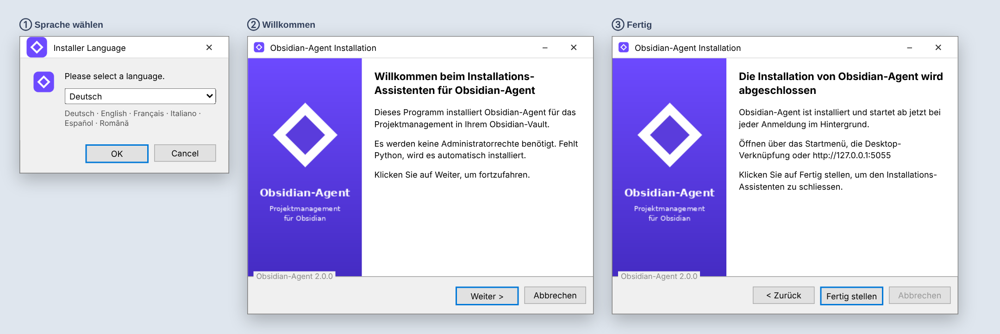

# ◆ Obsidian-Agent – Dokumentation · Documentation

[← Startseite / Home](../../README.md) · [English](../../readme_en.md) · [Español](../../readme_es.md)

## Anleitungen · Guides

| | Sprache / Language | Vollständige Anleitung | Kurzinstallation |
|---|---|---|---|
| 🇩🇪 | Deutsch | [Anleitung_DE.md](Anleitung_DE.md) | [↓](#-deutsch) |
| 🇬🇧 | English | [Guide_EN.md](Guide_EN.md) | [↓](#-english) |
| 🇫🇷 | Français | [Guide_FR.md](Guide_FR.md) | [↓](#-français) |
| 🇮🇹 | Italiano | [Guida_IT.md](Guida_IT.md) | [↓](#-italiano) |
| 🇪🇸 | Español | [Guia_ES.md](Guia_ES.md) | [↓](#-español) |
| 🇷🇴 | Română | [Ghid_RO.md](Ghid_RO.md) | [↓](#-română) |

## Downloads

| System | Datei / File |
|---|---|
| Windows 10 / 11 | [Obsidian-Agent-Setup-2.0.0-Windows.zip](../../Obsidian-Agent-Setup-2.0.0-Windows.zip) |
| macOS 10.15+ | [Obsidian-Agent-2.0.0-Mac.zip](../../Obsidian-Agent-2.0.0-Mac.zip) |
| Quellcode / Source, portable | [Obsidian-Agent-2.0.0-Quellcode.zip](../../Obsidian-Agent-2.0.0-Quellcode.zip) |

## Setup-Assistent · Setup assistant

① Sprache · Language → ② Weiter · Next → ③ Vault wählen · Choose vault → Fertig stellen · Finish

---

### 🇩🇪 Deutsch

1. `Obsidian-Agent-Setup-2.0.0-Windows.zip` herunterladen, entpacken und die `.exe` starten. Bei «Der Computer wurde durch Windows geschützt»: **Weitere Informationen → Trotzdem ausführen**.
2. Sprache **Deutsch** wählen, **Weiter**. Python und Autostart werden automatisch eingerichtet.
3. Im Ordner-Dialog den Obsidian-Vault wählen, **Fertig stellen**. Der Agent öffnet sich unter `http://127.0.0.1:5055`.

macOS: `.pkg` aus `Obsidian-Agent-2.0.0-Mac.zip` doppelklicken. Bei einer Warnung: **Systemeinstellungen → Datenschutz & Sicherheit → Dennoch öffnen**. → [Anleitung](Anleitung_DE.md)

### 🇬🇧 English

1. Download `Obsidian-Agent-Setup-2.0.0-Windows.zip`, unzip it and run the `.exe`. If “Windows protected your PC” appears: **More info → Run anyway**.
2. Choose **English**, click **Next**. Python and autostart are set up automatically.
3. Select your Obsidian vault in the folder dialog, click **Finish**. The agent opens at `http://127.0.0.1:5055`.

macOS: double-click the `.pkg` from `Obsidian-Agent-2.0.0-Mac.zip`. If warned: **System Settings → Privacy & Security → Open Anyway**. → [Guide](Guide_EN.md)

### 🇫🇷 Français

1. Téléchargez `Obsidian-Agent-Setup-2.0.0-Windows.zip`, décompressez-le et lancez le `.exe`. Si « Windows a protégé votre ordinateur » s'affiche : **Informations complémentaires → Exécuter quand même**.
2. Choisissez **Français**, cliquez sur **Suivant**. Python et le démarrage automatique sont configurés automatiquement.
3. Sélectionnez votre coffre Obsidian dans la boîte de dialogue, cliquez sur **Fermer**. L'agent s'ouvre à l'adresse `http://127.0.0.1:5055`.

macOS : double-cliquez sur le `.pkg` de `Obsidian-Agent-2.0.0-Mac.zip`. En cas d'avertissement : **Réglages Système → Confidentialité et sécurité → Ouvrir quand même**. → [Guide](Guide_FR.md)

### 🇮🇹 Italiano

1. Scaricare `Obsidian-Agent-Setup-2.0.0-Windows.zip`, estrarlo e avviare il `.exe`. Se compare «Windows ha protetto il PC»: **Ulteriori informazioni → Esegui comunque**.
2. Scegliere **Italiano**, fare clic su **Avanti**. Python e l'avvio automatico vengono configurati automaticamente.
3. Selezionare il vault di Obsidian nella finestra di dialogo, fare clic su **Fine**. L'agente si apre su `http://127.0.0.1:5055`.

macOS: fare doppio clic sul `.pkg` di `Obsidian-Agent-2.0.0-Mac.zip`. In caso di avviso: **Impostazioni di Sistema → Privacy e sicurezza → Apri comunque**. → [Guida](Guida_IT.md)

### 🇪🇸 Español

1. Descargue `Obsidian-Agent-Setup-2.0.0-Windows.zip`, descomprímalo y ejecute el `.exe`. Si aparece «Windows protegió su PC»: **Más información → Ejecutar de todas formas**.
2. Elija **Español** y haga clic en **Siguiente**. Python y el inicio automático se configuran automáticamente.
3. Seleccione su bóveda de Obsidian en el diálogo de carpeta y haga clic en **Terminar**. El agente se abre en `http://127.0.0.1:5055`.

macOS: haga doble clic en el `.pkg` de `Obsidian-Agent-2.0.0-Mac.zip`. Si aparece un aviso: **Ajustes del Sistema → Privacidad y seguridad → Abrir igualmente**. → [Guía](Guia_ES.md)

### 🇷🇴 Română

1. Descărcați `Obsidian-Agent-Setup-2.0.0-Windows.zip`, dezarhivați-l și porniți fișierul `.exe`. Dacă apare „Windows a protejat PC-ul”: **Mai multe informații → Rulează oricum**.
2. Alegeți **Română**, apoi **Înainte**. Python și pornirea automată sunt configurate automat.
3. Selectați vault-ul Obsidian în fereastra de dialog, apoi **Terminare**. Agentul se deschide la `http://127.0.0.1:5055`.

macOS: faceți dublu clic pe `.pkg` din `Obsidian-Agent-2.0.0-Mac.zip`. La avertisment: **Configurări sistem → Confidențialitate și securitate → Deschide oricum**. → [Ghid](Ghid_RO.md)

---

Die Abbildung des Setup-Assistenten ist eine Vorschau der Installationsschritte · The setup image is a preview of the installation steps.
