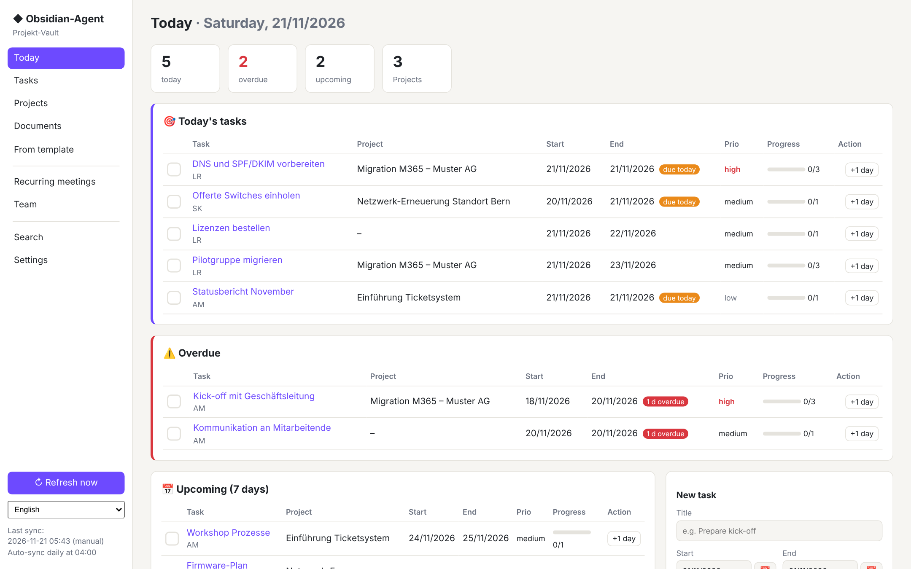
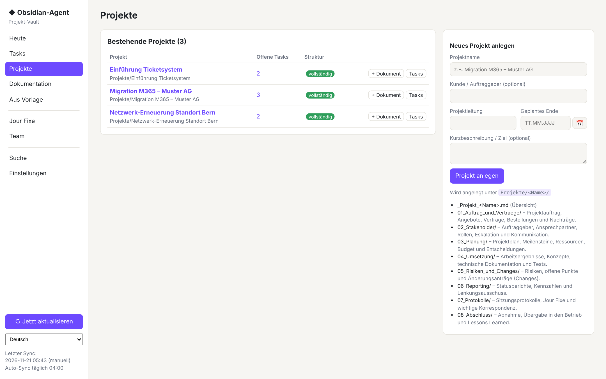
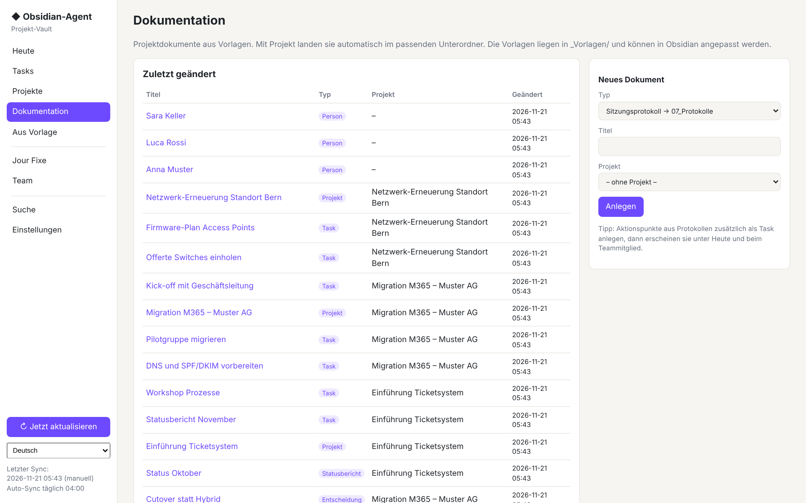
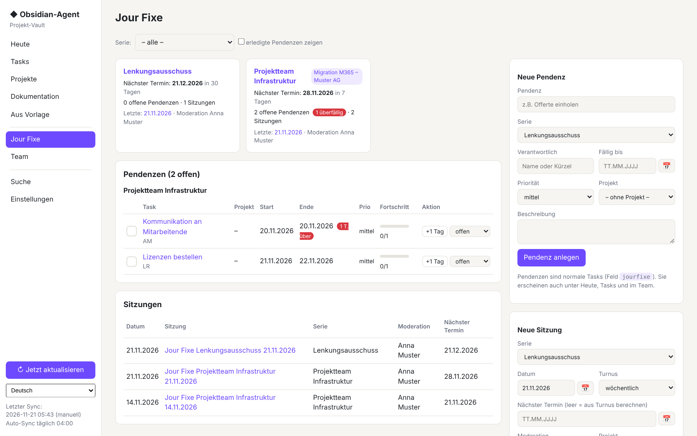
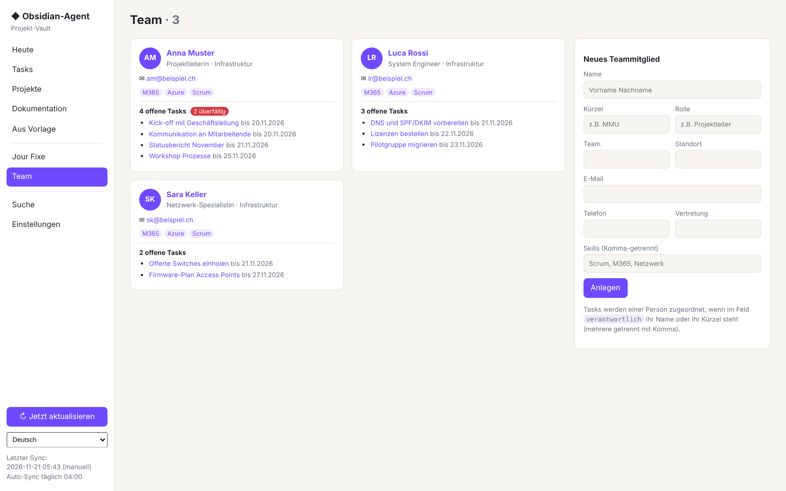
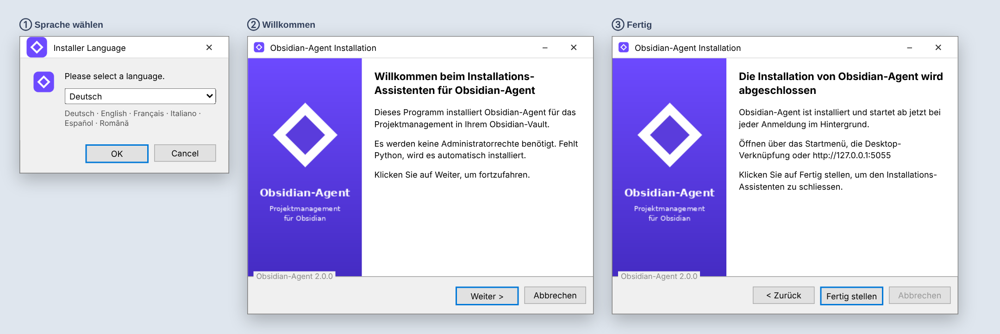

# ◆ Obsidian-Agent

[Deutsch](README.md) · **English** · [Español](readme_es.md)

**Project management right inside your Obsidian vault.**
Projects, tasks, minutes, recurring meetings and your whole team: at a glance, in the browser, and everything stays plain Markdown.

`Windows` `macOS` `Linux` `Python 3.9+` `runs on 127.0.0.1 only` `🇩🇪 🇬🇧 🇫🇷 🇮🇹 🇪🇸 🇷🇴`

---

## The problem

Obsidian is great for thinking and writing. But as soon as several projects, milestones, meetings and action items come together, everything is scattered across dozens of notes. Tasks hide in meeting minutes, due dates in checkboxes, and who does what by when is written down somewhere.

> What is due today, what is overdue, and who is taking care of it?

That question should take ten seconds to answer, not ten minutes.

## The solution

Obsidian-Agent puts a lean project management interface on top of your vault. No new tool, no cloud, no data silo: the agent reads and writes ordinary Markdown files.

| | |
|---|---|
| 🎯 **Everything at a glance** | Today, overdue and upcoming, across all projects and people. |
| 📝 **Markdown stays the source of truth** | Every note is a file in your vault. Keep working in Obsidian whenever you like. |
| 🔗 **One click into Obsidian** | Every title opens the note directly in Obsidian. |
| 🔒 **100 % local** | Runs only on your computer. No data leaves your device. |
| ⏰ **Works in the background** | Starts when you sign in and builds the daily overview every morning at 04:00, also as a note in Obsidian and on your phone. |
| 🌍 **Six languages** | German, English, French, Italian, Spanish and Romanian, including templates and folder names. |

## Features

### 🎯 Today: start the day with clarity

Today's tasks, overdue items and what is coming up in the next days, with priority, progress and owner. One click marks a task as done, another moves it to tomorrow. Create new tasks right here.

### 📁 Projects: structure from minute one

One click and every project gets the same clean filing structure, from mandate to closure:

`01_Mandate_and_Contracts` · `02_Stakeholders` · `03_Planning` · `04_Execution` · `05_Risks_and_Changes` · `06_Reporting` · `07_Minutes` · `08_Closure`

Plus a project overview with goals, milestones and open tasks. Folder names follow the chosen language.

### 📄 Documents: the right template in the right place

Meeting minutes, decision, risk, change request, stakeholder, status report and project closure. Each document is placed in the matching project folder automatically, with a consistent outline. You can adapt every template in Obsidian.

### 🗓️ Recurring meetings: no action item gets lost

Meeting series with frequency and next date. Every new meeting note automatically lists all open action items of the series. Action items are normal tasks and also appear under Today and with the team member.

### 👥 Team: who does what by when

Person cards with role, contact and deputy, plus each person's open and overdue tasks. Tasks are assigned simply by name or initials.

### ✅ Tasks: every task in one place

All tasks grouped into Today, Overdue, Planned and Done, filterable by project. Status via drop-down, progress from checkboxes, stored in any project folder you choose.

### And also

- 🔍 Full-text search across the whole vault
- 🧩 Custom templates with a preselected target folder
- 📲 Daily overview as a note in Obsidian, with a daily archive
- 📊 Optional Dataview queries in every project overview
- ⌨️ Command line for sync, today's list and new projects

## Why not just a plugin?

| | Obsidian-Agent | Obsidian plugins |
|---|:---:|:---:|
| Overview even when Obsidian is closed | ✅ | – |
| Daily refresh in the background | ✅ | – |
| Fixed project structure with one click | ✅ | – |
| Recurring meetings with an automatic action item list | ✅ | – |
| Daily history: who completed what and when | ✅ | – |
| Notes stay plain Markdown | ✅ | ✅ |
| Works together with Dataview | ✅ | ✅ |

## Ready in 5 minutes

### Windows

1. **[Download Obsidian-Agent-Setup-2.0.0-Windows.zip](Obsidian-Agent-Setup-2.0.0-Windows.zip)** and unzip it.
2. Run `Obsidian-Agent-Setup-2.0.0.exe`. If “Windows protected your PC” appears: **More info → Run anyway**.
3. Choose **English** in the language dialog, click **Next**, select your vault folder, click **Finish**.

No administrator rights needed. If Python is missing, it is installed automatically.

### macOS

1. **[Download Obsidian-Agent-2.0.0-Mac.zip](Obsidian-Agent-2.0.0-Mac.zip)**, unzip it and double-click `Obsidian-Agent-2.0.0.pkg`.
2. If macOS warns you: **System Settings → Privacy & Security → Open Anyway**.
3. Follow the installer and choose your vault. Open the agent from **Applications → Obsidian-Agent**.

The agent is then always available at **http://127.0.0.1:5055**.

📖 **[All guides and quick installation in 6 languages](obsidian-agent-readme/docs/README.md)** · [English guide](obsidian-agent-readme/docs/Guide_EN.md)

## Safe and risk-free

- 🔒 **Your data belongs to you.** Everything is Markdown in your vault, nothing goes to the internet.
- 🧹 **Clean uninstall.** Settings and database are backed up to the desktop. Your vault is never changed or deleted.
- 🔁 **Always reversible.** The database is only an index and is rebuilt from the vault.
- 👤 **No admin rights.** Per-user installation, even on managed company laptops.

---

**Search less. Get more done.**

*Obsidian-Agent: your vault, your projects, your overview.*

All screenshots show fictional sample data. The setup screenshot is a preview of the installer steps. Obsidian is a trademark of Dynalist Inc.; Obsidian-Agent is an independent project.
