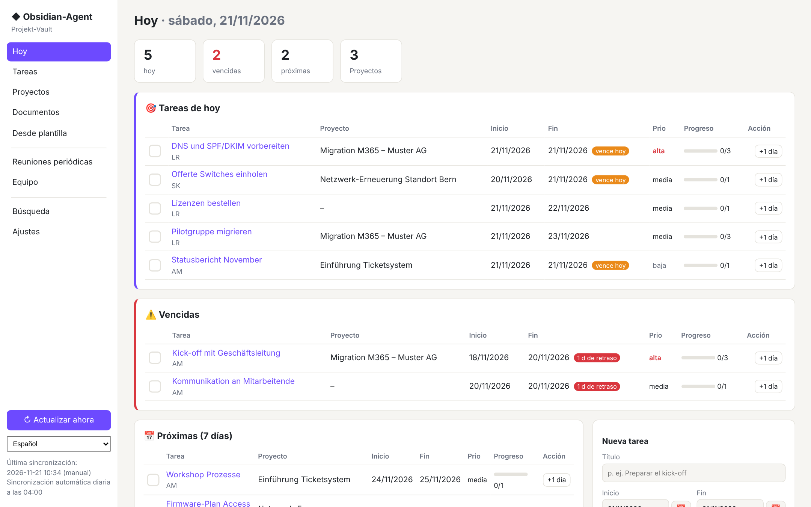
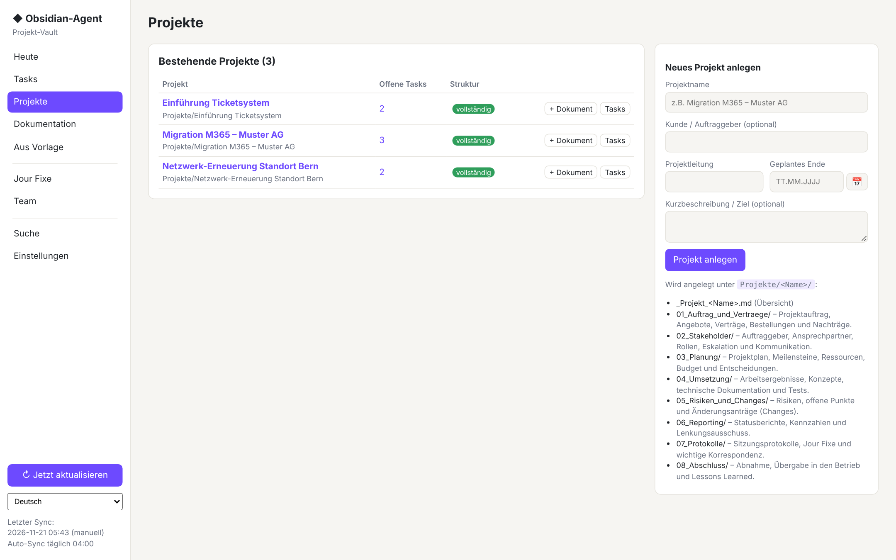
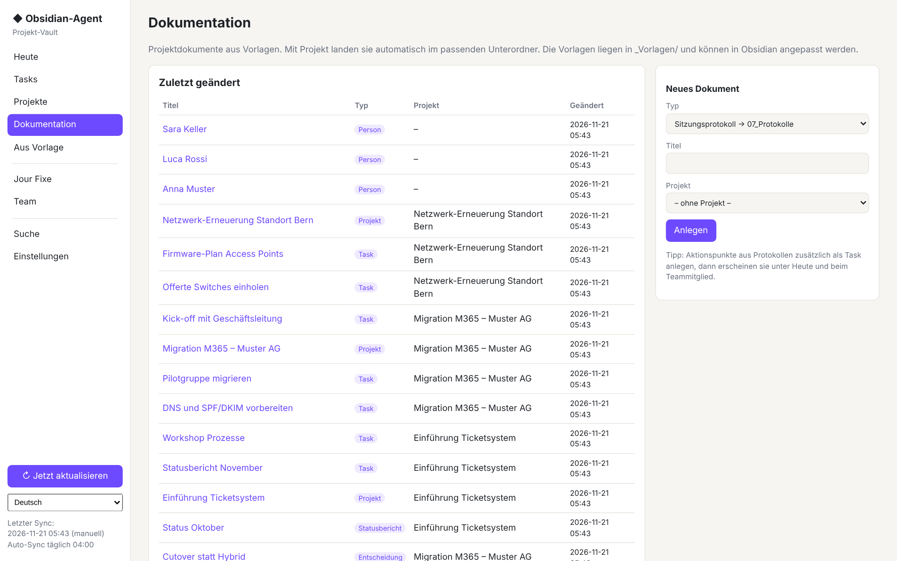
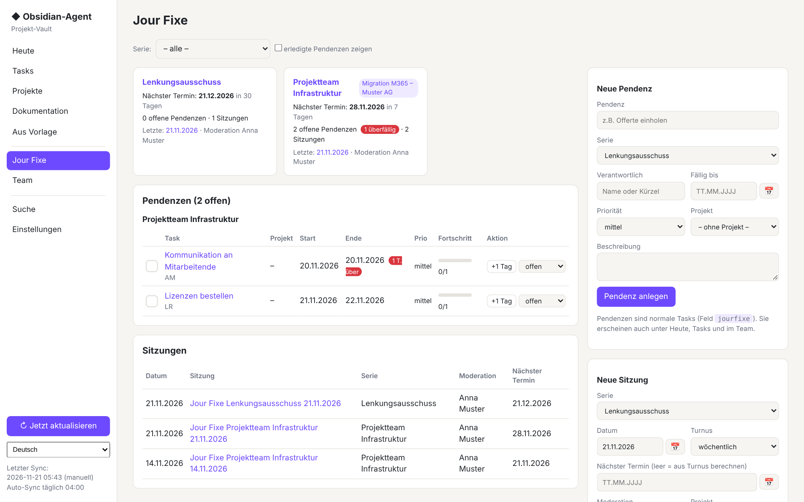
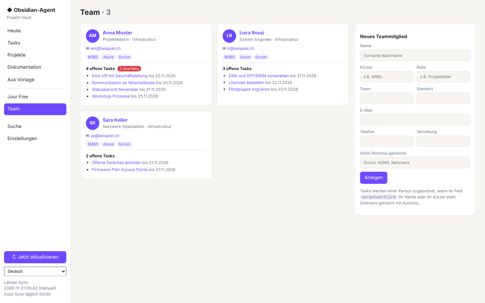
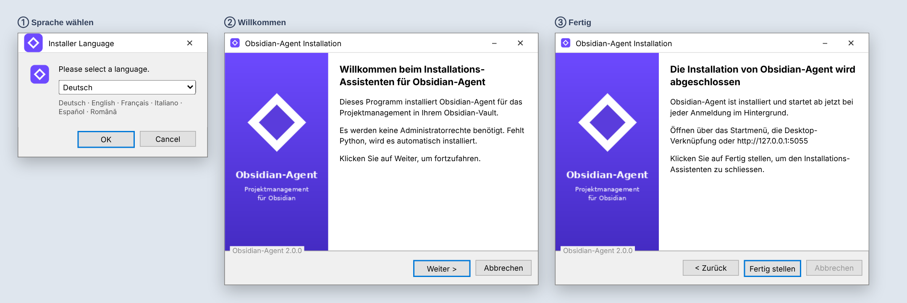

# ◆ Obsidian-Agent

[Deutsch](README.md) · [English](readme_en.md) · **Español**

**Gestión de proyectos directamente en su bóveda de Obsidian.**
Proyectos, tareas, actas, reuniones periódicas y todo el equipo: de un vistazo, en el navegador, y todo sigue siendo Markdown puro.

`Windows` `macOS` `Linux` `Python 3.9+` `solo en 127.0.0.1` `🇩🇪 🇬🇧 🇫🇷 🇮🇹 🇪🇸 🇷🇴`

---

## El problema

Obsidian es excelente para pensar y escribir. Pero en cuanto se juntan varios proyectos, hitos, reuniones y acciones pendientes, todo queda repartido en decenas de notas. Las tareas se esconden en las actas, los plazos en casillas de verificación, y quién hace qué y para cuándo está escrito en algún sitio.

> ¿Qué vence hoy, qué está atrasado y quién se encarga?

Esa pregunta debería responderse en diez segundos, no en diez minutos.

## La solución

Obsidian-Agent coloca una interfaz ligera de gestión de proyectos sobre su bóveda. Sin herramientas nuevas, sin nube, sin silos de datos: el agente lee y escribe archivos Markdown normales.

| | |
|---|---|
| 🎯 **Todo de un vistazo** | Hoy, vencido y próximo, para todos los proyectos y personas. |
| 📝 **Markdown sigue siendo la referencia** | Cada nota es un archivo de su bóveda. Siga trabajando en Obsidian cuando quiera. |
| 🔗 **Un clic a Obsidian** | Cada título abre la nota directamente en Obsidian. |
| 🔒 **100 % local** | Funciona solo en su ordenador. Ningún dato sale de su equipo. |
| ⏰ **Trabaja en segundo plano** | Se inicia al iniciar sesión y crea cada mañana a las 04:00 el resumen del día, también como nota en Obsidian y en el móvil. |
| 🌍 **Seis idiomas** | Alemán, inglés, francés, italiano, español y rumano, incluidas plantillas y nombres de carpeta. |

## Funciones

### 🎯 Hoy: el día empieza con claridad

Las tareas de hoy, las vencidas y lo que llega en los próximos días, con prioridad, progreso y responsable. Un clic la marca como completada, otro la mueve a mañana. Las tareas nuevas se crean aquí mismo.

### 📁 Proyectos: estructura desde el primer minuto

Con un clic, cada proyecto tiene la misma estructura ordenada, desde el encargo hasta el cierre:

`01_Encargo_y_Contratos` · `02_Partes_interesadas` · `03_Planificacion` · `04_Ejecucion` · `05_Riesgos_y_Cambios` · `06_Informes` · `07_Actas` · `08_Cierre`

Además, un resumen del proyecto con objetivos, hitos y tareas abiertas. Los nombres de carpeta siguen el idioma elegido.

### 📄 Documentos: la plantilla adecuada en el lugar adecuado

Acta de reunión, decisión, riesgo, solicitud de cambio, parte interesada, informe de estado y cierre del proyecto. Cada documento se guarda automáticamente en la carpeta del proyecto que corresponde, con una estructura uniforme. Todas las plantillas se pueden adaptar en Obsidian.

### 🗓️ Reuniones periódicas: ninguna acción se pierde

Series de reuniones con frecuencia y próxima fecha. Cada nueva nota de reunión incluye automáticamente todas las acciones abiertas de la serie. Las acciones son tareas normales y aparecen también en Hoy y en el miembro del equipo.

### 👥 Equipo: quién hace qué y para cuándo

Fichas con rol, contacto y suplente, y las tareas abiertas y vencidas de cada persona. La asignación se hace simplemente por nombre o iniciales.

### ✅ Tareas: todas en un solo lugar

Todas las tareas agrupadas en Hoy, Vencidas, Planificadas y Completadas, filtrables por proyecto. Estado mediante lista desplegable, progreso a partir de las casillas, guardadas en cualquier carpeta del proyecto.

### Y además

- 🔍 Búsqueda de texto completo en toda la bóveda
- 🧩 Plantillas propias con carpeta de destino preseleccionada
- 📲 Resumen del día como nota en Obsidian, con archivo diario
- 📊 Consultas Dataview opcionales en cada resumen de proyecto
- ⌨️ Línea de comandos para sincronizar, ver la lista de hoy y crear proyectos

## ¿Por qué no simplemente un plugin?

| | Obsidian-Agent | Plugins de Obsidian |
|---|:---:|:---:|
| Resumen aunque Obsidian esté cerrado | ✅ | – |
| Actualización diaria en segundo plano | ✅ | – |
| Estructura de proyecto fija con un clic | ✅ | – |
| Reuniones periódicas con lista automática de acciones | ✅ | – |
| Historial diario: quién completó qué y cuándo | ✅ | – |
| Las notas siguen siendo Markdown puro | ✅ | ✅ |
| Funciona junto con Dataview | ✅ | ✅ |

## Listo en 5 minutos

### Windows

1. **[Descargar Obsidian-Agent-Setup-2.0.0-Windows.zip](Obsidian-Agent-Setup-2.0.0-Windows.zip)** y descomprimirlo.
2. Ejecutar `Obsidian-Agent-Setup-2.0.0.exe`. Si aparece «Windows protegió su PC»: **Más información → Ejecutar de todas formas**.
3. Elegir **Español** en el diálogo de idioma, **Siguiente**, seleccionar la carpeta de la bóveda, **Terminar**.

No se necesitan derechos de administrador. Si falta Python, se instala automáticamente.

### macOS

1. **[Descargar Obsidian-Agent-2.0.0-Mac.zip](Obsidian-Agent-2.0.0-Mac.zip)**, descomprimirlo y hacer doble clic en `Obsidian-Agent-2.0.0.pkg`.
2. Si macOS muestra un aviso: **Ajustes del Sistema → Privacidad y seguridad → Abrir igualmente**.
3. Seguir el instalador y elegir la bóveda. El agente se abre desde **Aplicaciones → Obsidian-Agent**.

Después, el agente está siempre disponible en **http://127.0.0.1:5055**.

📖 **[Todas las guías e instalación rápida en 6 idiomas](obsidian-agent-readme/docs/README.md)** · [Guía en español](obsidian-agent-readme/docs/Guia_ES.md)

## Seguro y sin riesgos

- 🔒 **Sus datos le pertenecen.** Todo es Markdown en su bóveda; nada se envía a Internet.
- 🧹 **Desinstalación limpia.** Los ajustes y la base de datos se guardan en el escritorio. Su bóveda nunca se modifica ni se elimina.
- 🔁 **Siempre reversible.** La base de datos es solo un índice y se reconstruye a partir de la bóveda.
- 👤 **Sin derechos de administrador.** Instalación por usuario, también en portátiles corporativos gestionados.

---

**Buscar menos. Hacer más.**

*Obsidian-Agent: su bóveda, sus proyectos, su visión de conjunto.*

Todas las capturas muestran datos de ejemplo ficticios. La imagen del instalador es una vista previa de los pasos de instalación. Obsidian es una marca de Dynalist Inc.; Obsidian-Agent es un proyecto independiente.
